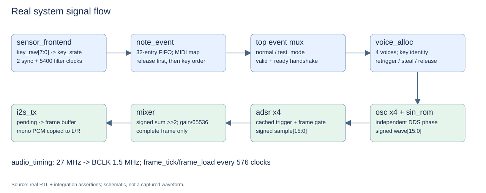
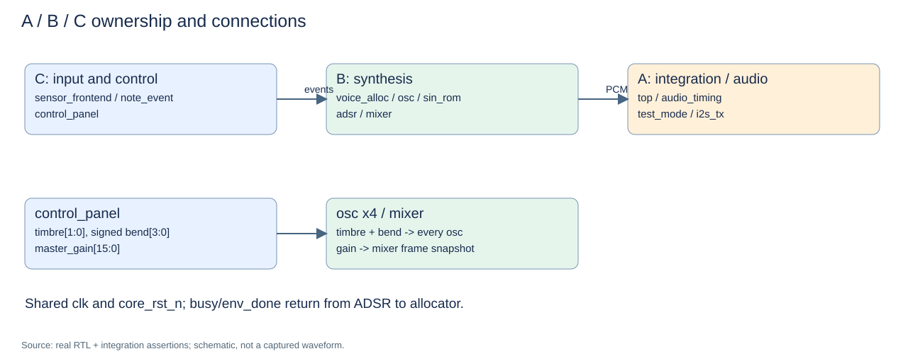
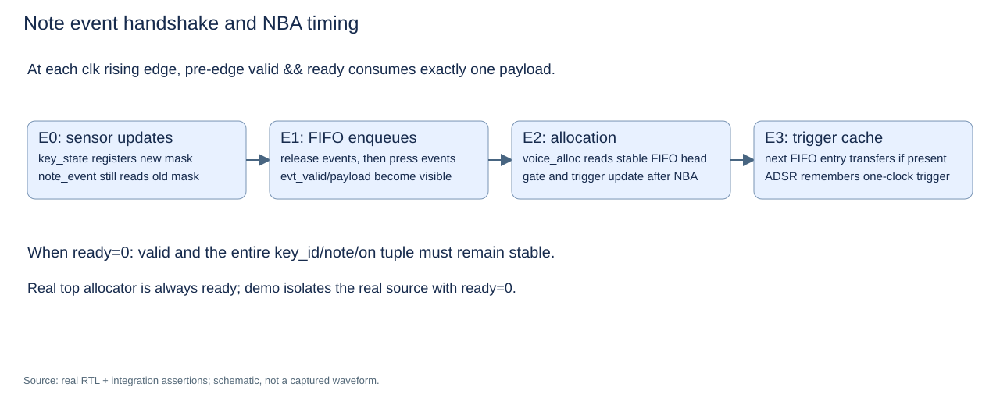
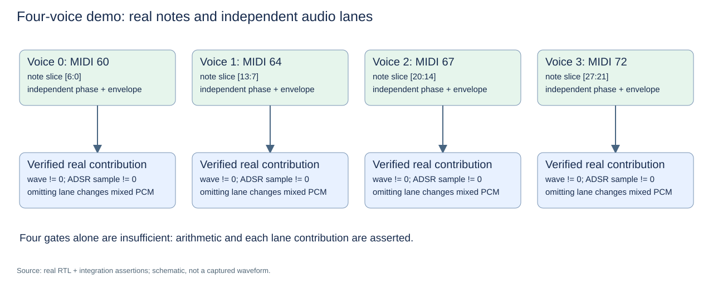
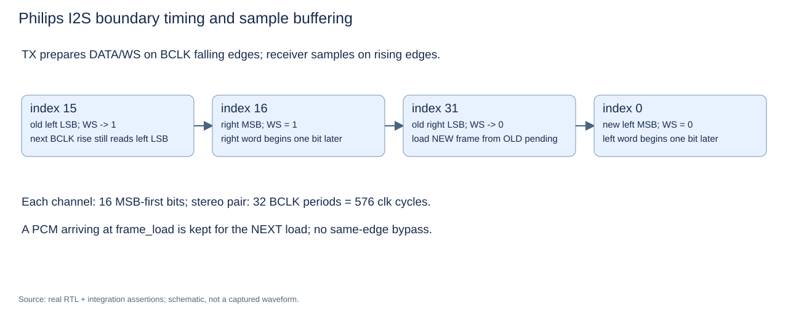
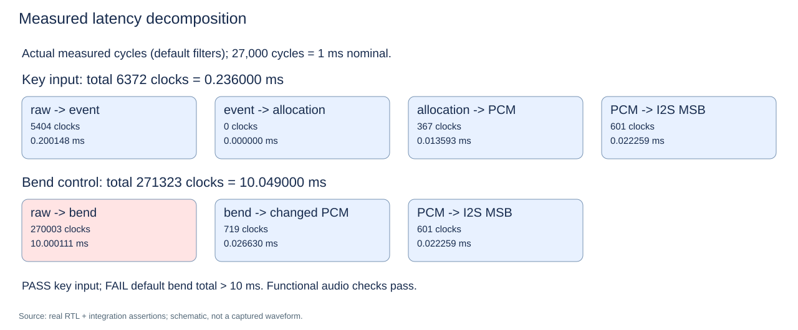

# A+B+C 真实整机联调报告

> 历史基线：本报告正文保留 CTRL_FILT=270000 时的真实测量和失败结果。正式默认值与最新验收见 [控制延迟修复报告](Control_Latency_Fix_Report.md)，请勿把这里的旧 FAIL 当作当前状态。

日期：2026-10-26（Asia/Shanghai）。工作目录：`F:\user\FPGA\FPGA_Music_integration`；基线：`ae57a73`，分支 `integration`。本轮未提交或推送。

## 1. 结论及证据范围

**正式四声部整机功能 PASS；默认面板控制到音频的 ≤10 ms 指标 FAIL。** 自动脚本因此返回 **1**，不能将本次整体结果写成全部通过。

| 验证项目 | 结果 | 实际证据 |
|---|---|---|
| A/B/C 单元及合同边界 | PASS | 12 个测试顶层逐项编译、运行退出 0，且有成功标记、无 FAIL |
| 正式 4 声部 top 编译 | PASS | `sources.f` 补齐 sin_rom；无 timescale 警告 |
| 正式 8 声部 top 编译 | PASS | `-Ptop.NVOICE=8`；仅证明编译，未声明 8 声部整机功能通过 |
| A：复位、模式锁存、运行中复位 | PASS | 第 4 拍释放 core_rst_n；模式运行中固定；复位清事件和声音 |
| B：真实四复音演示 | PASS | 四路波形、独立包络和逐路混音贡献均被检查；4 个 note_on 和 4 个 note_off |
| C：真实选音输入路径 | PASS | 单键、两键、四键、第五键抢占、旧键松开、Release 优先抢占、重按、短脉冲拒绝 |
| D：正式默认控制面板功能 | PASS | 270000 拍消抖；音色、+2/0/−2、双键、音量增减进入真实音频链 |
| E：外部 I2S | PASS | **8907** 个双声道帧与真实 PCM 队列逐字一致；复位后重新同步 |
| F：默认选音到 I2S 延迟 | PASS | **6372 拍 / 0.236000 ms**，一次实际输入相位测量 |
| F：默认弯音到 I2S 延迟 | **FAIL** | **271323 拍 / 10.049000 ms**，新配置的 PCM 来源经过队列与串行帧关联 |
| Gowin 正式 top 综合 | PASS | 实际 GowinSynthesis；12 个正式模块、正式参数、27 MHz，退出 0 |
| 真实板级 P&R / 完整 Setup/Hold | BLOCKED | top.cst 没有引脚；外部输入/输出时序及同步器例外不完整；未运行板级 P&R |
| 上板、DAC/功放、听感、实际传感器延迟 | NOT TESTED | 没有硬件测量，仿真不能代替 |

整机仿真执行 **3189021** 次检查。只有演示模式的保持/间隔被 defparam 缩短为 128 帧；传感器 **5400** 拍、面板 **270000** 拍、ADSR 的 **46875 Hz** 参数和音频分频均保持正式默认值。没有 B/C 替身、`force`、假事件、假混音或固定 PCM 注入。原 `tb/tb_top.v` 未修改，也未参与真实整机测试。

用户原先创建的空文件实际位于 `tb/tb/tb_top_integration.v`；保留原文件，在正确路径创建 `tb/tb_top_integration.v`。

## 2. 实际架构





所有逻辑只在 `clk` 域工作。`top` 处理外部复位和启动模式；原始选音输入经同步、独立滤波、事件 FIFO 后送声部分配器。每一路 DDS 都有独立相位、正弦 ROM 和包络；混音器按帧锁存音量，将真实 PCM 交给 I2S 双缓存。演示源仅替换事件源，经过同一套正式音频链。

## 3. 完整接口审计表

以下按 `NVOICE=4` 列实际宽度；公共复位均为低有效。PASS 表示本轮源码核对和相应仿真；不代表板级电气验证。

| 信号 | 源 → 目标 | 位宽/符号 | 时序合同及本轮检查 |
|---|---|---|---|
| clk | 板输入 → 全部模块 | 1 | 27 MHz 单一逻辑时钟；PASS |
| rst_n / core_rst_n | 外部 → top → 全体子模块 | 1 | 异步拉低、同步启动，第 4 拍释放；PASS |
| test_enable | 外部 → top.mode_sync | 1 | 两级同步，启动锁存，运行变化无效；PASS |
| key_raw | 外部 → sensor_frontend | 8 | 高有效，逐路两级同步；PASS |
| key_state | sensor_frontend → note_event | 8 | 稳定 5400 次滤波读数后接受变化；PASS |
| 面板五键 | 外部 → control_panel | 各 1 | 高有效、两级同步、独立消抖；功能 PASS，默认总延迟 FAIL |
| timbre | control_panel → 全部 osc | 2 | 单次按下在 0/1 间切换，长按不重复；PASS |
| bend | control_panel → 全部 osc | signed 4 | +2/0/−2、双键为 0；PASS |
| master_gain | control_panel → mixer | unsigned 16 | 16384 默认值；每次 ±4096，frame_tick 锁存；PASS |
| real_valid / real_ready | note_event ↔ top | 各 1 | 未选源 ready=0，背压保持；PASS |
| real_key / real_note / real_on | note_event → top | 3 / 7 / 1 | key 0..7，音号 60/62/64/65/67/69/71/72；先松后按再升序；PASS |
| test_valid / test_ready | test_mode ↔ top | 各 1 | valid 不依赖 ready，逐事件成交；PASS |
| test_key / test_note / test_on | test_mode → top | 3 / 7 / 1 | 四音 60/64/67/72，按下和释放顺序；PASS |
| evt_valid / evt_ready | top ↔ voice_alloc | 各 1 | 仅选中源成交；实际分配器始终 ready=1；PASS |
| evt_key / evt_note / evt_on | top → voice_alloc | 3 / 7 / 1 | 整组选择，不对两个 valid 直接相或；PASS |
| voice_note | voice_alloc → osc×4 | 28，切片 7 | 第 i 路 `[i*7 +: 7]`，第 0 路低位；PASS |
| voice_gate / voice_trigger | voice_alloc → adsr×4 | 各 4 | gate 为持键电平，trigger 为一拍；独立分配模型核对；PASS |
| voice_busy / env_done | adsr×4 → voice_alloc | 各 4 | Release 完成后归还；同拍重分配优先；PASS（冲突边界另由单元补充） |
| phase/lut_addr | osc → sin_rom | 32 / 8 | 相位高 8 位查表，连续相位；数学频率/波形参考核对；PASS |
| lut_dout | sin_rom → osc | signed 16 | 组合正弦表，无外部文件依赖；PASS |
| wave / wave_valid | osc → 本路 adsr | signed 16 / 1 | 消费 frame_tick 的 E0 输出，一拍 valid；PASS |
| sample / valid | adsr×4 → mixer | 64 / 4 | E1 更新；闲置路仍提交 valid=1、sample=0；PASS |
| frame_tick | audio_timing → osc/adsr/mixer | 1 | 每 576 拍一次；启动 DDS、快照 gate/trigger/gain；PASS |
| mixed_sample / mixed_valid | mixer → i2s_tx | signed 16 / 1 | E2 PCM；全路 valid 同拍接收；signed 求和、移位、增益、饱和；PASS |
| frame_load | audio_timing → i2s_tx | 1 | 与 frame_tick 同拍，索引 31 时消费旧 pending；PASS |
| bit_index | audio_timing → i2s_tx | 5 | 0..31，下降沿读旧索引再递增；PASS |
| bclk_fall_ce | audio_timing → i2s_tx | 1 | 与实际 BCLK 下降沿同一个 clk 边沿；PASS |
| bclk_rise_ce | audio_timing → top 内部 | 1 | 保留调试线，正式 top 不将其当时钟；源码核对 |
| bclk / lrclk | audio_timing → top 外部 | 各 1 | BCLK 高低各 9 拍，LRCLK 半周期 288 拍；PASS |
| i2s_data | i2s_tx → top 外部 | 1 | 下降沿准备，上升沿接收，WS 改变后一位延迟；PASS |
| overflow_count | note_event → top 内部 | 32 | FIFO 满计数；本轮修复饱和，单元边界 PASS |
| clip_count | mixer → top 内部 | 32 | 逐有效帧统计；本轮修复饱和，单元边界 PASS |
| underrun_count | i2s_tx → top 内部 | 32 | 首帧允许零，后续欠载饱和计数；单元及整机 PASS |

接线无位宽/符号/复位极性变更；发现的合同偏差已用边界测试定位并修复。`sources.f` 原有 11 个模块漏掉 B 的 ROM，现为 12 个正式模块；备用 `clk_gen`、旧 I2S 测试顶层和旧替身 TB 不参与真实 top。

## 4. 测试平台、接收模型和实际四复音



外部激励在下降沿后 1 ns 改变；寄存器结果在上升沿 NBA 后检查。事件 scoreboard 从真实 `key_state` 变化生成期望序列；分配模型独立记录键身份、gate、时间戳及抢占选择。没有把 DUT 分配结果直接当期望值。

每路 DDS 用数学频率计算校验 FCW（容差 0.01%，覆盖整数表四舍五入），按旧相位校验正弦 ROM/方波。包络模型独立模拟默认步长：Attack +71、Decay −2、Sustain 19660、Release −5；检查电平轨迹、完成脉冲和波形乘法。每帧混音独立计算 `(signed_sum >>> 2) * gain >>> 16` 并执行饱和。



| 声部 | 演示音号 | 非零波形次数 | 非零包络样本次数 | 去掉本路会改变混音的帧数 |
|---|---:|---:|---:|---:|
| 0 | 60 | 94 | 93 | 93 |
| 1 | 64 | 95 | 94 | 94 |
| 2 | 67 | 94 | 93 | 93 |
| 3 | 72 | 94 | 93 | 93 |

四路均覆盖波形正负两侧，超过检查门槛；实际四路贡献和逐帧混音算术都有断言支持。ADSR 单元额外覆盖满幅、Sustain、重触发和释放归零，不能只靠四个 gate 判定四复音。

## 5. I2S 合同和延迟测量



接收器只使用外部 BCLK/LRCLK/DATA 定位字边界，不读取 DUT `bit_index` 或 `frame_sample` 决定解码位序。WS 变化对应旧声道 LSB，下一次 BCLK 上升沿才取新声道 MSB。预期 PCM 来自真实混音器，经独立 pending/load 队列处理；同沿新 PCM 留到下一次装载。连续流欠载/输入溢出/削波统计均为 0。

从消费 `frame_tick` 的 E0 计：E0 OSC → E1 ADSR → **E2 mixer** → E3 TX pending → E576 下一次装载 → E594 准备左 MSB → **E603 在外部 BCLK 上升沿接收左 MSB**。2 拍的混音流水线满足 128 拍预算。



| 实测路径 | 分段周期 | 总周期 | 按 27 MHz 换算 |
|---|---|---:|---:|
| 原始选音 → 成交事件 → 分配 → 首个非零 PCM → 已验证 I2S 左 MSB | 5404 + 0 + 367 + 601 | 6372 | 0.236000 ms |
| 原始升音键 → bend 生效 → 使用新相位的 PCM → 已验证 I2S 左 MSB | 270003 + 719 + 601 | 271323 | **10.049000 ms，FAIL** |

时钟以 `#18.518518518`、1 ps 精度表示，仿真实际周期为 37.038 ns。计数以驱动输入前的最近上升沿为参考，输入在随后下降沿后 1 ns 改变。VCD 中实际原始选音时间为 3052413694 ps、对应 MSB 为 3288400311 ps，差 **0.235986617 ms**；原始升音时间为 89647998454 ps、对应 MSB 为 99697240209 ps，差 **10.049241755 ms**。名义周期换算与实际仿真时间均给出，未用加速消抖冒充性能结果。

这里测量的是一组具体相位，不声称已穷举全部输入相位。源码上，传感器两级同步与 5400 拍滤波、事件检测和消费、最多一帧等待、混音两拍以及下一帧发送，合计约 5404 + 576 + 2 + 601 拍；若首个样本恰为零还需考虑波形零点/包络量化。当前有效键和非零默认增益下实测有充分余量；静音增益下不存在“首个非零样本”，不定义该端点。

面板输出的确定时序：E1 更新 s1，E2 更新 s2，E3..E270002 累计 270000 次不一致，E270002 更新 db，E270003 更新 bend。**即使不计音频等待，默认配置本身已超过 270000 拍预算。** 不擅自降低消抖以隐藏失败。建议先由团队确认机械键稳定时间，再将消抖预算降至约 9 ms（例如 243000 拍）或采用按下快速响应/释放防抖策略；改变策略后必须重测所有输入相位和硬件抖动。该建议尚未应用。

## 6. 错误定位与修复

| 类别/负责人 | 实际问题与证据 | 最小修复及复测 |
|---|---|---|
| 工程清单/A 集成 | `sources.f` 编译缺 sin_rom；4/8 路分别缺 4/8 个实例 | 增加 `rtl/sin_rom.v`；4/8 正式 top 编译均退出 0 |
| 合同/RTL，B mixer | `|voice_valid` 接受部分帧；边界测试实测 valid=1、期望 0 | 改 `&voice_valid`；保留原数值算例，将静音声部也标有效，补部分帧拒收断言；PASS |
| 合同/RTL，B mixer | 累加仅 24 位，合同要求至少 32 位 | 累加改 32 位，乘积改 49 位、缩放改 33 位，保持算术与饱和定标；B/整机回归 PASS |
| 合同/RTL，C note_event | 满 FIFO 时溢出计数从 fffffffe 加 8 回绕为 00000006 | 改饱和加法；真实键变化填满 FIFO，再做统计边界 setup；PASS |
| 合同/RTL，B mixer | clip_count 到最大值后下一次削波回绕为 0 | 增加最大值保持；统计压力夹具复现再修复，正负削波均 PASS |
| 仿真声明/B | adsr、mixer、osc、sin_rom、voice_alloc 继承 timescale 警告 | 仅显式添加 1ns/1ps 声明；未改变算法或采样频率 |
| 性能/默认配置，C | 弯音总延迟 271323 拍 | 保留严格 FAIL 和非零退出；默认策略未擅自调整 |

`tb_contract_boundaries` 的统计预置只用于把计数器放到接近上限，避免数十亿次重复；真实 top 测试完全不写内部信号。合法 4/8 路满幅经余量和 16 位增益不会削波，因此另用 16 路实例作为**统计分支压力夹具**，不代表正式系统支持或验证了 16 复音。

此前的 C 组 NBA 采样修复、脚本 PATH 修复和 `tools/ref_c.py:252` 行尾清理已在基线合并提交内，本轮未重复修改。当前 Python 无行尾空白。

## 7. 自动化命令及反向验证

```powershell
# 单元回归 + 正式整机；默认面板性能 FAIL，预期整体退出 1。
powershell -NoProfile -ExecutionPolicy Bypass -File .\run_integration.ps1 -UnitTests

# 单独真实整机，保留相同严格性能判定。
powershell -NoProfile -ExecutionPolicy Bypass -File .\run_integration.ps1

# 原 C 组入口仍为 ALL C TESTS PASSED，退出 0。
$env:IVL='E:\app\software\oss-cad-suite\bin'
.\run_sim_c.bat

# 源清单编译检查（不是功能仿真）。
iverilog -g2001 -Wall -s top '-Ptop.NVOICE=4' -o sim/top_c_integration_4.vvp -c sources.f
iverilog -g2001 -Wall -s top '-Ptop.NVOICE=8' -o sim/top_c_integration_8.vvp -c sources.f

# 正式参数、27 MHz 目标的 Gowin 综合；退出 0。
powershell -NoProfile -ExecutionPolicy Bypass -File .\run_gowin_synthesis.ps1

# 从真实日志重建 SVG。
python tools/integration_diagrams.py
```

脚本使用同一个 `E:\app\software\oss-cad-suite\bin` 中的编译器和运行器，且把同套件的 `lib` 放在其他 MSYS DLL 之前。不修改系统 PATH。编译命令和原始输出保存在 `sim/*.compile.log`、`sim/*.run.log`；总回归结果为 `sim/integration_results.tmp`。完整控制波形在 `sim/tb_top_integration.vcd`（不记录 27 MHz 时钟及消抖计数器，控制文件体积）；时钟边沿由断言和 BCLK 波形校验。

在隔离副本中进行四次反向验证，正式 RTL 未被这些错误修改：

| 故意错误 | 实际捕获结果 |
|---|---|
| TX 的 PCM 输入断开置零 | cycle 1476：外部 frame 2 左声道 0000，真实期望 0001，退出 1 |
| I2S 位序反转 | cycle 1476：外部 frame 2 左声道 8000，真实期望 0001，退出 1 |
| osc 音号切片反向 | cycle 27：声部 3 FCW=23971696，数学期望 47943391，退出 1 |
| 帧间偷偷增加 DDS 相位 | cycle 20：声部 3 相位 00000001，期望保持 00000000，退出 1 |

这些检查证明真实接线、位序和逐路独立音高错误不会仅靠 gate/X 检查蒙混通过。

## 8. Gowin 与板级验收边界

真实工具为 `E:\app\gowin\Gowin\Gowin_V1.9.12.04_x64\IDE\bin\GowinSynthesis.exe`。正式顶层 `top`、12 个源文件、正式默认参数和 27 MHz 已实际综合。Standalone 引擎首次即使传入 SDC 仍按 100 MHz 报告；增加 `-global_freq 27` 后实际报告确认时钟周期 **37.037 ns / 27.000 MHz**。

综合报告中的资源表和估算频率见下方“最终综合摘录”。**综合估算 Fmax 不是布局布线后的 Setup/Hold 签字**；没有用早期 `top_i2s_test` 的结果替代本次正式 top。

旧 `.gprj` 仍只有早期 I2S 链，源相对路径解析至不存在的 gowin/rtl。保留该历史工程；正式验证使用新脚本的确定源清单。正式 `top.cst` 没有有效引脚绑定，`top.sdc` 仅有 create_clock，缺少完整 I/O 延迟和 CDC 约束；因此未生成可上板 bitstream、未声称板级 P&R 或完整 STA 通过。`gw_sh --help` 在当前受限环境提示无法写用户缓存日志，且返回 0，所以其退出码不作为成功证据；直接综合器已实际产出网表与报告。

器件使用 **GW2AR-LV18QN88C8/I7**，依据 [Sipeed 官方 Tang Nano 20K 文档](https://wiki.sipeed.com/hardware/en/tang/tang-nano-20k/nano-20k.html)。历史 C 测试记录中的 GW2A-LV18PG256C8/I7 与该板不符，不能将那次资源统计套用于本板。本轮未猜测 MAX98357A 和传感器 GPIO 接法。

## 9. 尚需完成

- **FAIL：** 团队确认消抖策略后解决默认控制总延迟，做全部相位和硬件抖动测试。
- **BLOCKED：** 明确实际接线并填写 CST，补完整 SDC，再执行正式 P&R 和 Setup/Hold/CDC 检查。
- **NOT TESTED：** 8 声部完整功能、长期稳定性、FIFO 持续满期间快速反转的逐边沿保留、板上功放/听感/噪声/实际端到端延迟。
- FIFO 满后的实现会重试**状态差**，不能保证保留满队列期间所有快速反转边沿及全部批次顺序；实际 top 接收器始终 ready，当前正常输入路径不产生背压。已验证饱和计数，不将其描述为无限背压下无损。

本轮不覆盖有效接口规范，不修改原开发工作目录，不提交仿真/综合产物。修改归属和执行时间见 [调试日志](Integration_Debug_Log.md)，重复验证步骤见 [检查清单](Integration_Validation_Checklist.md)。

## 10. 最终综合摘录与 Git 状态

最终命令：`powershell -NoProfile -ExecutionPolicy Bypass -File .\run_gowin_synthesis.ps1`，进程退出 **0**。原始报告：`sim/gowin_top.tmp/top_syn.rpt.html`；网表：`sim/gowin_top.tmp/top.edf`，均不加入 Git。

| 综合报告项目 | 实际值 |
|---|---|
| 目标器件/顶层 | GW2AR-LV18QN88C8/I7 / top |
| Clock Summary | 37.037 ns / 27.000 MHz |
| Logic utilization | 4075 / 20736（20%）；报告内含 3837 LUT + 238 ALU |
| LUT 分类统计 | 3825 |
| Register | 1200（8%），Latch=0 |
| BSRAM | 4 / 46（9%），pROM=4 |
| DSP 分类 | MULT18X18=5，MULTALU36X18=4 |
| 综合估算 Fmax | 45.204 MHz，22 logic levels |
| 警告 | 4 条 NL0002，sin_rom 模块优化提示；无综合错误 |

这张表是综合后的实际统计，不是布线后时序报告；不能据 45.204 MHz 估算值宣布 27 MHz Setup/Hold 已签字。

Git 修改均留在工作区，未暂存、未提交。已有 C 合并是 ae57a73，本次不再处于合并未完成状态。修改的既有文件：sources.f、B 的 rtl/mixer.v 和 tb/tb_mixer.v、C 的 rtl/note_event.v，以及 B 五模块的 timescale 声明。新增：真实整机/边界测试、两个 PowerShell 脚本、图示生成器和本目录文档/SVG。用户的空 tb/tb/tb_top_integration.v 保留为未跟踪文件。A 的正式 top/audio_timing/i2s_tx/test_mode 未修改；原始开发目录和远程分支未修改。
