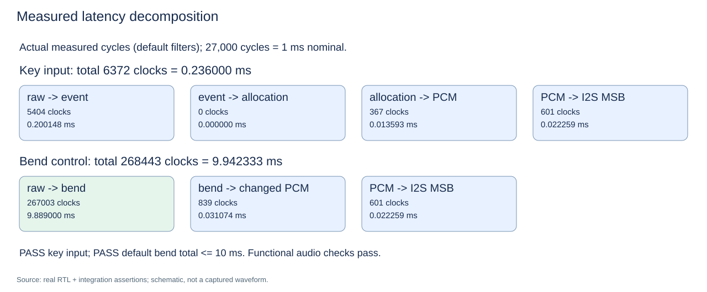

# 正式控制面板到 I2S 延迟修复

日期：2026-10-26（Asia/Shanghai）。目录：`F:\user\FPGA\FPGA_Music_integration`；分支 `integration`，基线 HEAD `ae57a73`。原有未提交工作保留，本轮没有提交、推送、merge 或 reset。

## 1. 根因与修改依据

修复前的真实整机记录是 `270003 + 719 + 601 = 271323` 拍，即 10.049 ms。270000 拍消抖已占满 10 ms 总预算，之后仍必须经历同步、输出寄存、DDS 新相位传播和 I2S 双缓存；因此属于正式默认值的预算分配问题，不能通过增大延迟上限或缩短 TB 专用参数解决。

本轮将 **正式 RTL 的 CTRL_FILT 从 270000 改为 267000**。在 27 MHz 下，消抖时间为 9.888889 ms；两级同步加一拍输出后，配置生效周期为 267003。没有改变消抖算法、按键边沿检测、音色、signed 弯音、音量钳位、复位、时钟或采样率。

稳定输入、当前理想 RTL 时序下的保守分析：

| 阶段 | 保守周期 |
|---|---:|
| 输入同步、消抖、配置输出寄存 | 267003 |
| 等待首次读取新 FCW 的 frame_tick（覆盖同沿 NBA 仍读旧值） | 576 |
| 下一 frame_tick 使用新相位输出波形 | 576 |
| OSC → ADSR → mixer 的 PCM 生产 | 2 |
| PCM 生产 → 已验证的外部左声道 MSB | 601 |
| 总计 | **268758** |
| 与不变的 270000 拍验收上限之间的余量 | **1242** |

这是稳定输入和当前流水线的保守界限，不把持续按键抖动的消抖等待宣称为固定时间。音频帧对齐会影响实际后处理周期，因此不把旧 719 拍开销机械沿用到新配置；实际测量见本报告末节。

## 2. 最小功能改动与测试保护

| 文件 | 本轮差异和原因 |
|---|---|
| rtl/control_panel.v | 仅改正式默认值 267000 和相关注释；所有端口、计数/同步逻辑不变 |
| tb/tb_top_integration.v | CONTROL 改为 267000；每次启动断言 DUT 的实际默认参数一致，禁止 TB 专用缩短值；BUDGET 保持 270000；保留全部既有功能检查，增加明确 F-control PASS，并使失败消息报告实际总延迟 |
| run_b_tb.sh | 修复真实发现的失败文本未影响退出码问题，详见下节；未改 B 的算法或 TB 断言 |
| tools/ref_c.py | Python 参考模型默认值同步为 267000，原逻辑不变 |
| docs/interfaces.md | 升为 V1.2，写明正式默认、总预算和最坏帧对齐分析；端口合同仍沿用 V1.1 |
| GOWIN_SIM_README.md | 更新控制默认值说明 |
| docs/test_records.md / sim/README.md / 联调检查清单与日志 | 记录本次真实复测；旧 FAIL 明确作为历史记录保留 |
| tools/integration_diagrams.py / 延迟 SVG | 从真实日志生成新周期分解，图中 PASS/FAIL 根据不变的 270000 上限计算；保留修复前图供历史报告引用 |

`tb_control_panel.v` 保持不变：CTRL=4 是原有功能回归的加速参数，按下/松开精确周期、长按、双键、音量边界和复位断言均保留。整机另使用未覆盖的真实默认参数，并在每次 boot 验证实际值。`run_integration.ps1` 的编译选项、源清单、失败检测和非零退出机制均未修改。

成员 A 的 top/audio_timing/i2s_tx/test_mode 和成员 B 的声音合成 RTL 均与本轮开始时一致。没有改变 270000 拍上限，没有注释失败断言，没有假事件、假 PCM 或 `force` 注入真实整机。

## 3. 非零失败退出码验证

正式 RTL 修改前，新增默认合同检查实测报：

```text
FAIL [A reset/startup] ... formal default CTRL_FILT actual=270000 expected=267000; no TB filter override
INTEGRATION_EXIT=1
```

这证明只改 TB 的 CONTROL 常量、却不改正式默认值不会蒙混过关。原来的 F-control 失败测量也保留在 `sim/control_latency_before.log`。

B 组旧脚本存在另一项真实问题：在隔离副本中让振荡器频率错误地加倍，`tb_osc_timbre` 明确打印 7 个失败并以 `$finish` 返回 0，旧脚本竟继续打印 `ALL PASS (-g2012)`、退出 0。本轮仅修复脚本的成功判定，检查进程/管道退出码、FAIL 文本和真实 `=== PASS (0 errors) ===` 汇总。

相同负向副本复测后：

```text
=== FAIL (7 errors) ===
SOME TESTS FAILED (-g2012)
B_NEGATIVE_AFTER_EXIT=1
```

正式 B RTL 和断言未应用该错误，正常五项均通过。负向副本只在忽略的 sim 临时目录，未加入正式源、IDE 索引或 Git。

## 4. 执行环境及顺序

使用同套 `E:\app\software\oss-cad-suite\bin\iverilog.exe` 和 vvp，并将该套件的 bin/lib 置于 PATH 前部，避免其他 MSYS DLL 混入。

按用户指定顺序实际执行：

```powershell
$env:IVL='E:\app\software\oss-cad-suite\bin'
$env:PATH="$env:IVL;E:\app\software\oss-cad-suite\lib;$env:PATH"
.\run_sim_c.bat
& 'D:\Git\bin\bash.exe' ./run_b_tb.sh g2012
.\run_integration.ps1
```

本轮未重新执行 Gowin 综合、P&R、STA 或板测，不沿用修复前网表来宣称新默认值已硬件验收。相关历史资源/仿真证据仍保留在原联调报告；正式板级约束工作不因本轮功能修复自动完成。

## 5. 工作区保护

本轮开始时记录了 33 个既有修改/未跟踪文件的哈希。对原有 A/B RTL、真实功能单元 TB 和整机脚本做基线核对，保留所有不属于本次默认值与文档同步的内容。原有历史报告没有删除；修复前延迟图保存为 `images/latency_before_filter_fix.svg`，旧报告继续引用旧测量。

最终 Git 状态和空白检查结果与下方实际测试结果一并记录；生成的 VVP/VCD、负向副本和日志均留在忽略目录，不自动暂存或提交。

## 6. 最终实际结果

按上方顺序实际执行，没有跳过断言：

| 测试 | 真实结果 | 退出码 |
|---|---|---:|
| C：sensor_frontend / control_panel / note_event | ALL C TESTS PASSED | 0 |
| B：mixer / adsr / voice_alloc / osc_timbre / chain | 五项各 PASS (0 errors)，ALL PASS (-g2012) | 0 |
| 正式整机 | A/B/C/D/E/F-key/F-control 全 PASS | 0 |
| Python C 参考模型 | ALL REFERENCE CHECKS PASSED | 0 |

整机控制台原始摘录：

```text
LATENCY key raw_event=5404 event_alloc=0 alloc_pcm=367 pcm_i2s_msb=601 total=6372 clocks (0.236000 ms)
LATENCY control raw_config=267003 config_pcm=839 pcm_i2s_msb=601 total=268443 clocks (9.942333 ms)
PASS [F-control] default control-to-I2S=268443 clocks <=270000; margin=1557 clocks
PASS [D] default 267000-cycle debounce; timbre, +/-2/0, gain and real audio propagation
PASS [E] external Philips I2S decoded=8847 stereo frames; exact produced PCM, 16-bit MSB-first, LR polarity, reset resync
PASS [F-key] default sensor raw-to-I2S <=10ms; max frame-to-PCM=2 clocks
RESULT assertions=3174265 functional=PASS performance_failures=0
PASS: tb_top_integration all checks passed
INTEGRATION_EXIT=0
```

总延迟 `268443 / 27000 = 9.942333ms`，比不变的 10ms 上限留出 `1557 / 27000 = 0.057667ms`。正式默认值减少 3000 拍后，音频帧相位改变，后处理从 719 变为 839 拍；所以实际改善为 2880 拍，并非直接套用候选估算的 268323 拍。

日志：`sim/control_latency_c.log`、`sim/control_latency_b.log`、`sim/control_latency_final.log`、`sim/control_latency_reference.log`。失败退出码证据：`sim/control_latency_contract_red.log`、`sim/control_b_negative_before.log`、`sim/control_b_negative_after.log`。波形及编译产物仍在 sim 忽略目录。



## 7. Git 与后续交接

最终执行 `git status --short --branch`，分支仍为 integration；工作区保留原有未提交集成修改，当前暂存区差异为空。`git diff --check`、`git diff --cached --check` 均退出 0，tools/ref_c.py 第 252 行无行尾空白。生成的 VVP/VCD、综合产物和 sim 临时夹具均受忽略规则保护，未自动暂存或提交。

后续针对 sin_rom 综合警告的定点诊断也已完成，正式 RTL 未再修改；其独立测试、综合网表证据及再次通过的整机回归见 [Sin ROM 综合诊断报告](Sin_ROM_Synthesis_Diagnostic_Report.md)。该后续任务单独补充了振荡器 -1 半音断言及诊断工具，不属于控制路径算法改动。
